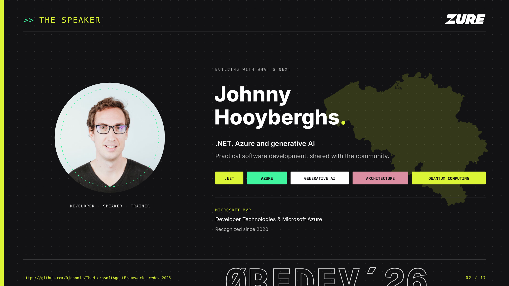
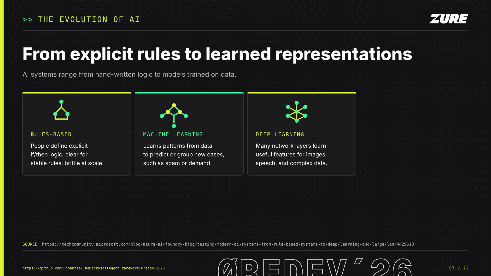
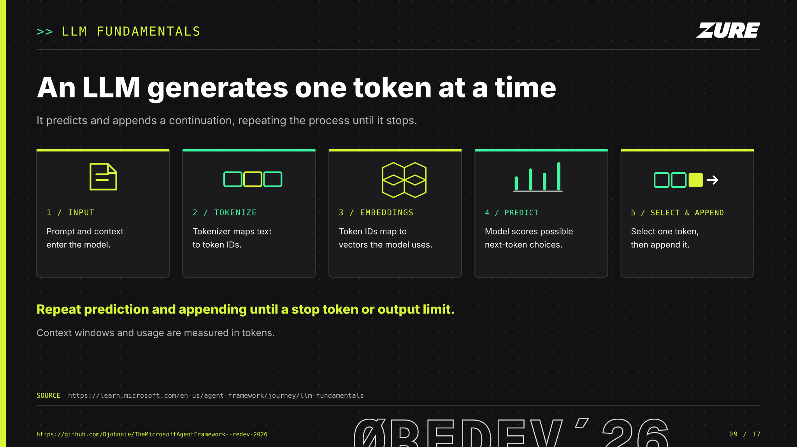
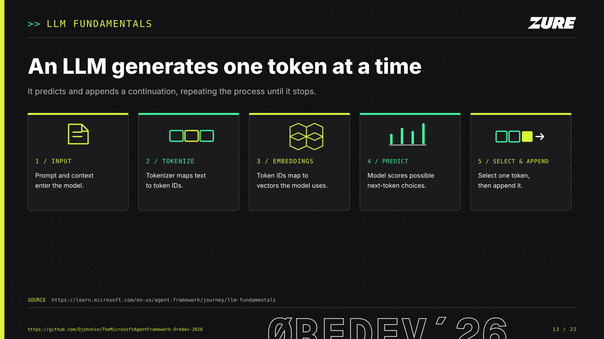
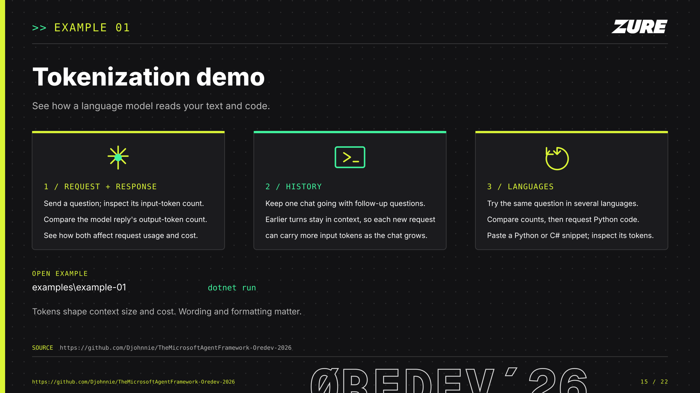

# Enable GenAI in Your Applications

**Johnny Hooyberghs · Øredev 2026 · Malmö, Sweden**

This repository accompanies the talk **“Enable GenAI in your applications using .NET, Azure and the Microsoft Agent Framework.”** It introduces a practical path from familiar .NET applications to generative AI, cloud services, and agentic workflows.

Open the [offline slide preview](_slides/index.html) to navigate all seventeen slides with the arrow keys, or browse the individual slides below. Each slide includes a short takeaway and an explanation of its place in the presentation.

## Presentation slides

### Slide 1 / Enable GenAI in your applications

> **TL;DR:** Build GenAI into your applications with .NET, Azure, and the Microsoft Agent Framework.

The opening slide introduces Johnny Hooyberghs's Øredev 2026 session and its focus: **Enable GenAI in your applications using .NET, Azure and the Microsoft Agent Framework**. A central AI mark is connected to the application, cloud, and agent-framework labels, framing the talk around the technologies working together.

The visual identity follows Øredev's near-black and electric-lime palette, with Geist Mono, Inter, and Outfit typefaces. The 16:9 SVG is designed to be readable on a presentation screen.

### Slide 2 / Johnny Hooyberghs

> **TL;DR:** Meet your guide to building with .NET, Azure, and generative AI.

The speaker introduction positions Johnny Hooyberghs as a developer, speaker, and trainer focused on practical software development. The .NET, Azure, and generative AI labels preview the areas brought together in the session.

Microsoft MVP recognition in Developer Technologies and Microsoft Azure, held since 2020, adds context to the speaker's community and technology background. A subtle silhouette of Belgium appears behind the text, recolored in Øredev's electric lime to complement the portrait and the slide's dark theme.

### Slide 3 / Scan to visit the repository

> **TL;DR:** Scan the QR code to open this repository and follow along.

A large QR code links directly to the [presentation repository](https://github.com/Djohnnie/TheMicrosoftAgentFramework--redev-2026), where attendees can revisit the slides, resources, and updates. The code is embedded as a local SVG asset and is also clickable in the slide.

The charcoal layout pairs the call to action with the repository address for people viewing the deck on screen.

### Slides 4–8 / The evolution of AI

> **TL;DR:** Compare AI systems built from explicit rules, learned patterns, deep networks, and generative models.

Five slides reveal the four cards one at a time, comparing explicit if-then rules, machine learning, deep neural networks, and generative models. The sequence describes a shift in approach without implying that newer methods replace every earlier one.

### Slide 9 / How large language models generate text

> **TL;DR:** An LLM tokenizes its input, predicts a distribution for the next token, and appends one token at a time.

The diagram follows an LLM request from prompt and context through tokenization, embeddings, next-token prediction, and token selection. The model appends each selected token and repeats until it reaches a stopping condition; the source explains that token counts also determine context-window limits and usage.

### Slide 10: Example 01 Tokenization demo

> **TL;DR:** Configure Microsoft Foundry, run the Token Visualizer, and compare local token counts with API usage.

This hands-on example invites attendees to configure Foundry access, inspect how the Token Visualizer splits prompts and code into tokens, and compare local counts with usage reported by the API. The runnable project is in [`examples\example-01`](examples/example-01/README.md).

### Slides 11–16 / The Agent Framework

> **TL;DR:** Reveal the framework's agents, harness agents, workflows, integrations, and language support in sequence.

The six-slide sequence keeps the title, footer, and linked source in place as it reveals the overview, agents, harness agents, workflows, integrations, and .NET, Python, and Go (preview) support.

### Slide 17 / Thank you and questions

> **TL;DR:** Thank participants and invite questions.

The closing slide thanks participants, opens the floor for questions, and keeps the repository QR code available for anyone who wants the slides and resources.
